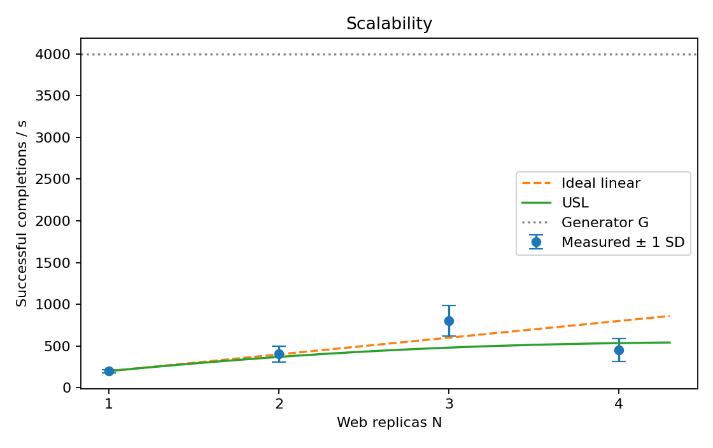
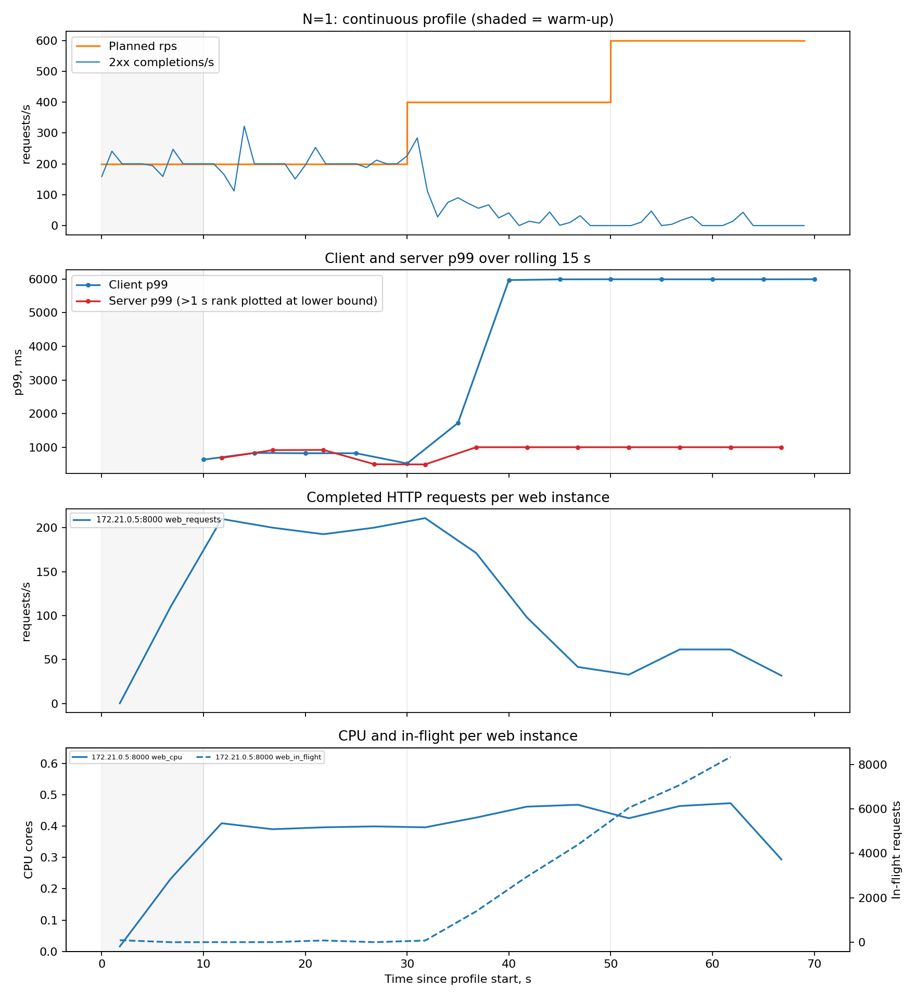
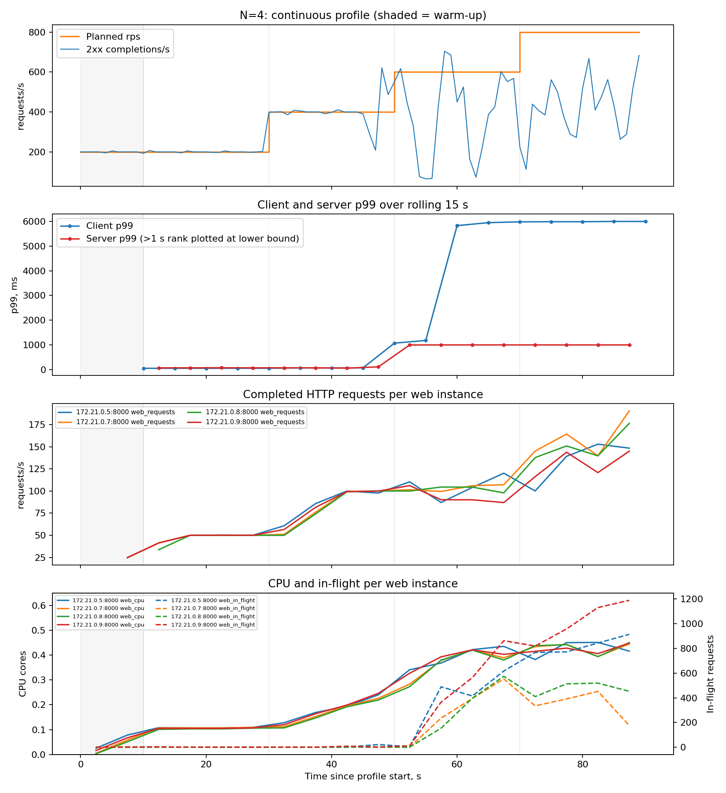
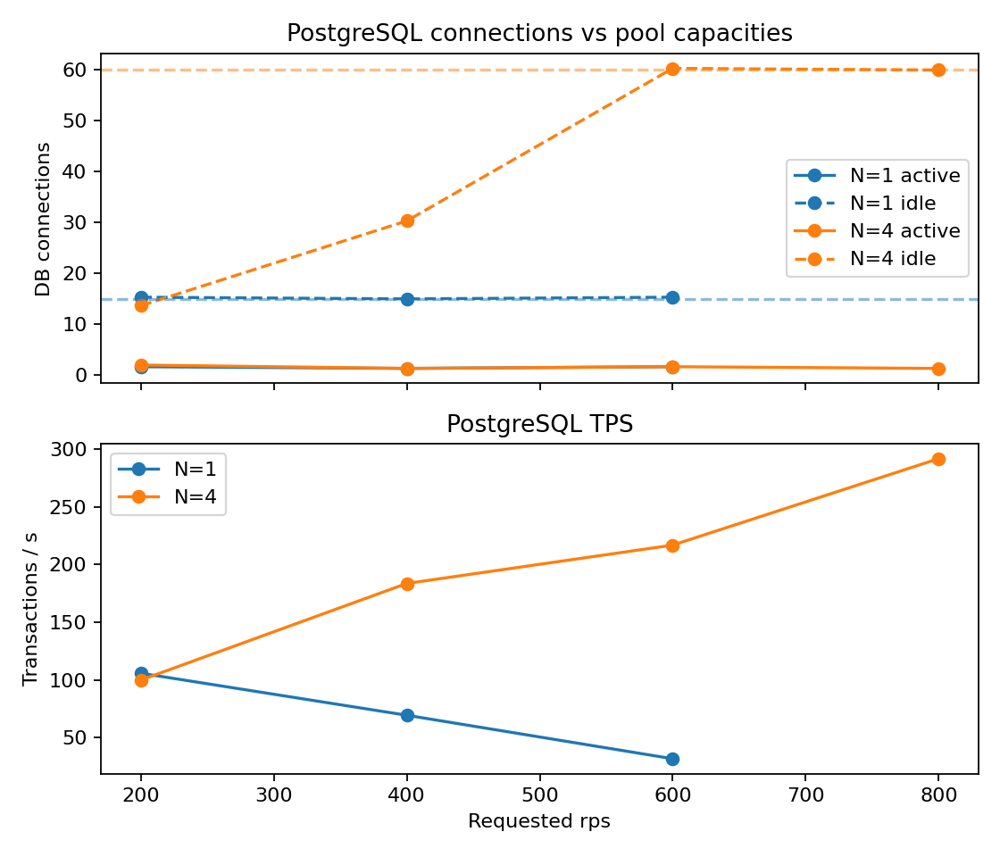

# Звіт з лабораторної роботи №2

**Дисципліна:** «Високопродуктивні розподілені обчислювальні системи»  
**Тема:** метрики сервісу і межа масштабованості  
**Варіант 2:** `DB_POOL_SIZE=15`, набір бакетів Г1 — 5, 10, 25, 50, 100, 250, 500, 1000 мс; додаткова метрика М2 — `postgres-exporter`.

## 1. Мета, проєктування і відповідність варіанту

Мета роботи — доповнити CRUD-сервіс із [лабораторної №1](REPORT.md) метриками Prometheus, виміряти його пропускну здатність на 1–4 web-екземплярах одним безперервним ступінчастим прогоном для кожного N та оцінити параметри універсального закону масштабованості (USL).

Проєктні рішення, означення метрик, критерії приймання й план доказів зафіксовано у [LAB2_DESIGN.md](LAB2_DESIGN.md). Архітектура предметної області не змінилася: FastAPI → прикладний сервіс → порт репозиторію → asyncpg → PostgreSQL. Один контейнер `web` запускає один процес Uvicorn; це підтверджено `docker top` у [infra_check.json](results/lab2_final/infra_check.json). Ліміти лабораторної №1 збережено: 0,5 CPU і 384 MiB на web.

Реалізовано:

- `http_requests_total{method,path,status}` з шаблоном маршруту, а не конкретним `id`;
- `http_request_duration_seconds{method,path}` з **точно** заданими межами Г1 без додаткових бакетів;
- `http_requests_in_flight` і `GET /metrics`;
- `GET /livez`, який не звертається до БД, та окремий DB-aware `GET /healthz`;
- `X-Pod`: значення `POD_NAME`, а за його відсутності — hostname контейнера;
- asyncpg-пул з `max_size=DB_POOL_SIZE=15`, без overflow;
- exec-форма `CMD ["uvicorn", ...]` та закриття пулу в lifespan під час SIGTERM;
- Prometheus зі scrape interval 5 s, іменованим томом і `dns_sd_configs` типу A з refresh 5 s;
- `postgres-exporter` для варіанта М2;
- nginx `/noop`, який повертає 204 без звернення до web.

PostgreSQL і web не мають опублікованих портів; назовні відкрито nginx `8080` і Prometheus `9090`. Фактичний `compose ps`, обмеження контейнерів, мережеві порти, процеси та повні відповіді `/metrics` кожної репліки збережено в [infra_check.json](results/lab2_final/infra_check.json).

## 2. Означення метрик і методика

Перед серією створено 100 записів. Сценарій — `GET /referrals/{id}` через nginx із циклічним вибором одного зі 100 ідентифікаторів.

Означення величин:

- задана інтенсивність — кількість запланованих стартів за секунду;
- фактична інтенсивність надсилання — кількість реально розпочатих HTTP-викликів за секунду;
- досягнута інтенсивність — кількість завершених у секунду відповідей 2xx;
- timeout 5 s входить до `non_2xx` і додатково рахується в окремому полі `timeouts`;
- помилка з'єднання — транспортний виняток без HTTP-коду, крім timeout;
- клієнтська затримка починається в запланований момент, тому містить schedule lag і чергу генератора;
- клієнтські p50/p95/p99 у посекундному файлі рахуються за всіма завершеними спробами; p99 лише успішних відповідей збережено як окрему діагностичну величину;
- серверний p99 — `histogram_quantile(0.99, sum by(le)(rate(..._bucket[15s])))` з оновленням кожні 5 s;
- `X(N)` — найбільше середнє число 2xx-завершень за останні 15 s сходинки; перші 5 s сходинки відкинуто;
- розкид — вибіркове стандартне відхилення тих самих 15 посекундних значень.

Генератор асинхронний, open-loop, без штучного ліміту worker-пулу. Прогрів триває 10 s при 200 rps. Далі в **одному процесі без пауз** ідуть 20-секундні сходинки 200, 400, 600… rps. Прогін завершується після двох послідовних сходинок із `X < 0,9·rate` або після сходинки, яка досягла G. Усі заплановані запити зрештою були передані в мережеві задачі; для кожного збережено плановий, фактичний і завершальний час, код, тип помилки, pod, повну latency й schedule lag. Посекундні похідні файли відтворюються скриптом [analyze_lab2.py](scripts/analyze_lab2.py).

Між незалежними N web-процеси пересоздаються, nginx перезапускається, а профіль починається лише після трьох послідовних idle-зрізів `http_requests_in_flight`. Збережені підтвердження дренажу: [drain](results/lab2_final/drain). Це усуває домішку серверної черги попереднього перевантаженого профілю.

## 3. Перевірки стенда й API

Основні команди:

```powershell
python -B scripts/run_lab2.py
python -B scripts/analyze_lab2.py
python -B scripts/verify_lab2_results.py
python -B scripts/check_lab2_infra.py
python -B scripts/check_lab2_shutdown.py
python -B scripts/check_lab2_liveness.py
python -B scripts/check_lab2_tests.py
```

Фактичні результати:

- Prometheus `/api/v1/targets` показав **4/4 web targets UP**; 40 послідовних `/livez` розподілилися рівно по 10 на кожну репліку ([infra_check.json](results/lab2_final/infra_check.json));
- `/livez=200`, `/healthz=200`, `/noop=204`, Prometheus API `=200`; прямий `/metrics` кожного web повернув 200;
- повна CRUD-перевірка має 30 записів із методом, шляхом, payload, HTTP-кодом, повним тілом і заголовками; перевірено межі PostgreSQL BIGINT та відсутність HTTP 500 ([api_check.json](results/lab2_final/api_check.json));
- під час `docker stop --timeout 10` однієї з двох реплік генератор за 10 s отримав **1000/1000 2xx**, 0 non-2xx, 0 timeout, 0 connection errors, а код завершення контейнера дорівнює 0 ([graceful_stop_r100.json](results/lab2_final/graceful_stop_r100.json));
- при зупиненій БД `/livez` залишився 200, а `/healthz` став 503; потім БД автоматично піднято ([liveness_check.json](results/lab2_final/liveness_check.json));
- регресійні тести: **19/19 OK**, зокрема точні бакети, timeout→non-2xx, облік завершення запиту з попередньої сходинки та заборона розриву безперервного профілю ([tests.json](results/lab2_final/tests.json)).

## 4. Межа генератора G

`/noop` перевірено через той самий опублікований порт без наперед заданої верхньої межі. Безперервний прогін містив 22 сходинки. Найвище середнє — **G=4000,0 2xx/s** на сходинці 4000 rps. На 4200 rps `X=101,9`, а p95 schedule lag зріс до 14,6 s; наступна сходинка 4400 rps також не досягла 90%. Отже зупинка відбулася саме після двох послідовних недоборів, а не через штучний cap.

Raw зберігається локально; його SHA-256 і команда відтворення наведені в [raw/README.md](results/lab2_final/raw/README.md). Компактний підсумок: [generator_ceiling.json](results/lab2_final/generator_ceiling.json). Значення `X(N)` нижче становлять не більше 20,1% G, а останні сходинки кожного N не досягли 90% плану, тому жодна точка не класифікована generator-limited. Повтор із удвічі меншим CPU-лімітом за умовою завдання не потрібний.

## 5. Результати ступінчастих прогонів

У таблиці наведено всі сходинки; формат клітинки: `X, 2xx/s (SD)`. Жирним позначено максимум для N.

| N | 200 rps | 400 rps | 600 rps | 800 rps | 1000 rps | 1200 rps |
| ---: | ---: | ---: | ---: | ---: | ---: | ---: |
| 1 | **200,0 (19,8)** | 30,7 (29,8) | 7,2 (13,2) | — | — | — |
| 2 | 200,1 (0,3) | **403,4 (98,2)** | 401,1 (157,0) | 189,7 (100,9) | — | — |
| 3 | 200,0 (0,0) | 401,4 (5,4) | 604,9 (91,8) | **803,4 (185,2)** | 658,6 (109,9) | 604,1 (97,4) |
| 4 | 200,0 (2,6) | 400,3 (86,5) | 394,6 (223,9) | **454,3 (137,5)** | — | — |

Зведення для виграшної сходинки:

| N | Сходинка, rps | X(N) ± SD, 2xx/s | C(N) | p99 клієнта, ms | p99 сервера | non-2xx | timeout | conn. errors | CPU/web, cores | in-flight/web |
| ---: | ---: | ---: | ---: | ---: | ---: | ---: | ---: | ---: | ---: | ---: |
| 1 | 200 | 200,0 ± 19,8 | 1,000 | 517 | 495 ms | 0% | 0 | 0 | 0,395 | 27,0 |
| 2 | 400 | 403,4 ± 98,2 | 2,017 | 755 | 875 ms | 0% | 0 | 0 | 0,359 | 25,3 |
| 3 | 800 | 803,4 ± 185,2 | 4,017 | 2694 | >1000 ms | 0% | 0 | 0 | 0,429 | 120,3 |
| 4 | 800 | 454,3 ± 137,5 | 2,272 | 5995 | >1000 ms | 28,30% | 3497 | 2087 | 0,431 | 692,4 |

`non-2xx` містить timeout за правилом завдання; connection errors наведено окремо і не входять до цієї частки. На всіх виграшних сходинках dispatch ratio дорівнює 1,0. p95 schedule lag: 1,16; 1,14; 1,14 і 32,44 ms відповідно — значно менше кроку 20 s. Тому генератор не пояснює спад N=4. Первинні raw зберігаються локально та описані в [raw/README.md](results/lab2_final/raw/README.md); компактні сходинки: [series](results/lab2_final/series), Prometheus: [prometheus](results/lab2_final/prometheus).







Обидві часові діаграми мають спільну вісь від початку відповідного прогону. На них окремо показано request rate, CPU та in-flight **кожної** web-репліки. Якщо ранг серверного p99 потрапив у `+Inf`-бакет, на графіку показано нижню межу `>1 s`, а не точне значення 1000 ms.

## 6. Порівняння p99 для N=1

| План, rps | p99 клієнта, ms | p99 успішних 2xx, ms | p99 сервера | Бакет | Максимальна похибка |
| ---: | ---: | ---: | ---: | --- | ---: |
| 200 | 517 | 517 | 495 ms | (250; 500] ms | 250 ms |
| 400 | 5995 | 5727 | >1000 ms | за останньою межею | зверху не обмежена |
| 600 | 5996 | 5932 | >1000 ms | за останньою межею | зверху не обмежена |

Клієнтський p99 включає чергу nginx, мережевий час, schedule lag і timeout-спроби. Серверна гістограма бачить тільки обробку всередині web та також може містити запити, відповідь на які клієнт уже не дочекався. Тому різниця між квантилями не є точним «мережевим часом». Повні розрахунки містить `n1_p99_comparison` у [analysis.json](results/lab2_final/analysis.json).

## 7. USL

Використано `C(N)=X(N)/X(1)` і лінійну форму

`N/C(N)-1 = σ(N-1)+κN(N-1)`.

МНК без вільного члена за N=2,3,4 дав від'ємну початкову оцінку σ, тому відповідно до завдання її зафіксовано на нулі та переоцінено κ однопараметрично:

- **σ = 0**;
- **κ = 0,0412715**;
- **N\* = sqrt((1-σ)/κ) = 4,922**;
- прогноз X: 369,5; 480,9; 535,0 2xx/s для N=2,3,4;
- RMSE для N>1: **192,9 2xx/s**.

Число N\*=4,922 є лише формальним результатом моделі. Виміряний максимум був при N=3, N=3 вийшов надлінійним, а N=4 різко впав; великий RMSE та SD показують, що чотири точки погано описуються гладкою USL-кривою. Тому з цих даних не можна стверджувати, що практичний оптимум справді дорівнює п'яти реплікам. Потрібна окрема довша серія повторів для статистичної оцінки, але вона не підміняє передбачений завданням один прогін на N.

## 8. Ресурси на сходинці X(4) і метрика М2

На виграшній сходинці N=4, 800 rps, два фактичні `docker stats --no-stream` усередині вимірювального вікна дали:

| Компонент | CPU | Пам'ять |
| --- | ---: | ---: |
| web-1…web-4 | 48,32–53,38% кожний | 70,64–91,83 MiB / 384 MiB |
| PostgreSQL | 16,17–18,45% | 140,7–141,0 MiB |
| nginx | 19,24–19,80% | 37,53–37,71 MiB |
| генератор | 73,84–77,52% | 84,09–90,48 MiB |
| CPU хоста | 59–69% | — |

Збережені знімки: `n4_winning_resource_samples` у [analysis.json](results/lab2_final/analysis.json), повний часовий ряд — [n4_profile.json](results/lab2_final/stats/n4_profile.json).

Prometheus на цій сходинці: 0,431 CPU core і 692,4 in-flight у середньому на web; PostgreSQL — 62 backend-з'єднання, з них у середньому 1,33 active і 60 idle, 291,7 transaction/s. Добуток `N·pool_size=60`; ще два з'єднання належать службовим клієнтам/exporter. Отже пули відкрили максимальну кількість з'єднань, але майже всі вони були idle: дані **не підтверджують** дефіцит DB connection slots. CPU БД і proxy також не наблизилися до одного повного ядра. Графік М2:



Підтверджений локальний ліміт — CPU-квота кожної web-репліки: усі чотири контейнери перебували біля 50%, одночасно з різким ростом in-flight і timeout. Генератор не є лімітом (`X(4)=454,3 << 0,9G=3600`, p95 lag 32 ms). Єдиний **спільний** ресурс, сигнал якого помітно зріс порівняно з N=3, — CPU хоста: 59–69% проти 20%; це робить конкуренцію за CPU/планувальник Docker найсильнішим кандидатом на додаткову деградацію N=4. Проте хост не досяг 100%, а історичних per-process host counters немає. Тому причинність не доведена: коректний висновок обмежено підтвердженими факторами — насичення CPU-квот web, велика черга, підвищене сумарне завантаження хоста; називати БД, nginx або хост єдиним доведеним bottleneck за цим прогоном не можна.

## 9. Відтворюваність і незалежна перевірка

Raw-файли не редагуються. [verify_lab2_results.py](scripts/verify_lab2_results.py) незалежно від аналізатора перечитує часові мітки кожного HTTP-запиту, заново обчислює 15 посекундних значень, X, SD, timeout/connection errors, перевіряє безперервні межі сходинок і повторно розв'язує USL без NumPy. Результат — `verification_passed=true`; для кожного raw записано SHA-256 у [independent_verification.json](results/lab2_final/independent_verification.json).

Попередній технічний прогін виявив методичну помилку: наступний N починався, поки старі web-процеси ще виконували запити після клієнтських timeout. Його не змішано з фінальними вимірюваннями; причина виключення описана в [lab2_excluded_no_drain/README.md](results/lab2_excluded_no_drain/README.md), а великі файли збережені лише локально. У фінальній серії генератор і точка відліку latency не змінювалися; змінено лише оркестрацію між незалежними N — пересоздання web і доказаний drain.

Первинні джерела: `results/lab2_final/raw`, `prometheus`, `stats`, `targets`, `drain`, `environment.json`. Похідні артефакти: `per_second`, `analysis.json`, `independent_verification.json` і графіки. Усі команди генератора разом із часом, exit code та stdout збережено в `logs`.

## 10. Інженерні альтернативи

1. **Ручний Prometheus middleware** обрано замість `prometheus-fastapi-instrumentator`: стороння бібліотека скорочує код, але ручний варіант гарантує саме задані бакети й контроль шаблону path без нової залежності.
2. **`postgres-exporter`** обрано замість власного SQL-sampler у генераторі: sampler дав би частіші зрізи, але додавав би запити до БД і окрему часову шкалу; exporter прямо вимагається варіантом М2 й синхронізований із Prometheus.
3. **DNS A discovery** обрано замість Docker socket service discovery: Docker SD дав би більше labels, але вимагав би передати Prometheus привілейований доступ до Docker socket; A discovery достатній і прямо заданий роботою.
4. **Асинхронний open-loop генератор** обрано замість thread pool: пул потребував би тисяч потоків і міг би стати прихованим обмежувачем; async-процес показав G=4000 і малий schedule lag на робочих точках.

## 11. Матриця вимог

| Крок завдання | Доказ виконання |
| ---: | --- |
| 1 | Метрики, точні бакети, шаблон path, `/metrics`, один процес: код, тести та [infra_check.json](results/lab2_final/infra_check.json) |
| 2 | `/livez`, `X-Pod`, `DB_POOL_SIZE=15`, max pool: код, [liveness_check.json](results/lab2_final/liveness_check.json), [infra_check.json](results/lab2_final/infra_check.json) |
| 3 | Exec CMD, lifecycle shutdown, stop під навантаженням, exit 0 і 0 помилок: [graceful_stop_r100.json](results/lab2_final/graceful_stop_r100.json) |
| 4 | Prometheus 5 s, volume, DNS A 5 s, exporter, 4/4 UP: Compose/config і [infra_check.json](results/lab2_final/infra_check.json) |
| 5 | Безперервний профіль, усі посекундні поля, timeout→non-2xx, latency від schedule: [raw](results/lab2_final/raw), [per_second](results/lab2_final/per_second) |
| 6 | nginx `/noop`, необмежений прогін, G=4000, два miss: [generator_ceiling.json](results/lab2_final/generator_ceiling.json) |
| 7 | По одному фінальному прогону N=1…4, X/SD/step/p99/errors/CPU/in-flight, Docker resources: [analysis.json](results/lab2_final/analysis.json), [environment.json](results/lab2_final/environment.json) |
| 8 | N=1 і N=4: усі задані часові графіки, включно з per-instance req/s, CPU та in-flight: [figures](results/lab2_final/figures) |
| 9 | p99 кожної сходинки N=1, bucket і похибка: розділ 6 та [analysis.json](results/lab2_final/analysis.json) |
| 10 | C(N), σ, κ, N*, точки ±SD, USL та λN: розділ 7 і [usl.png](results/lab2_final/figures/usl.png) |
| 11 | Синхронні Docker/host stats, Prometheus, М2 для N=1/4 і обмежений ресурсний висновок: розділ 8, [stats](results/lab2_final/stats), [postgres_variant.png](results/lab2_final/figures/postgres_variant.png) |

## 12. Використання генеративної моделі і межі висновків

Генеративна модель застосована для проєктування, реалізації генератора й аналізатора, підготовки тестів, графіків і тексту звіту. Після цього результати незалежно перевірено автотестами, прямими HTTP-відповідями, Prometheus targets, Docker inspect/top/stats і окремим перерахунком із raw без імпорту аналізатора.

Робота відтворює всі обов'язкові кроки. Автоматизований фінальний аудит доказів і посилань збережено в [requirements_audit.json](results/lab2_final/requirements_audit.json). Обмеження сформульовано явно: USL-fit має великий RMSE, а єдина причина спаду N=4 не ізольована контрольованим експериментом. Тому звіт наводить формальні параметри моделі та підтверджені ресурсні фактори, але не робить сильнішого причинного висновку, ніж дозволяють збережені дані.
