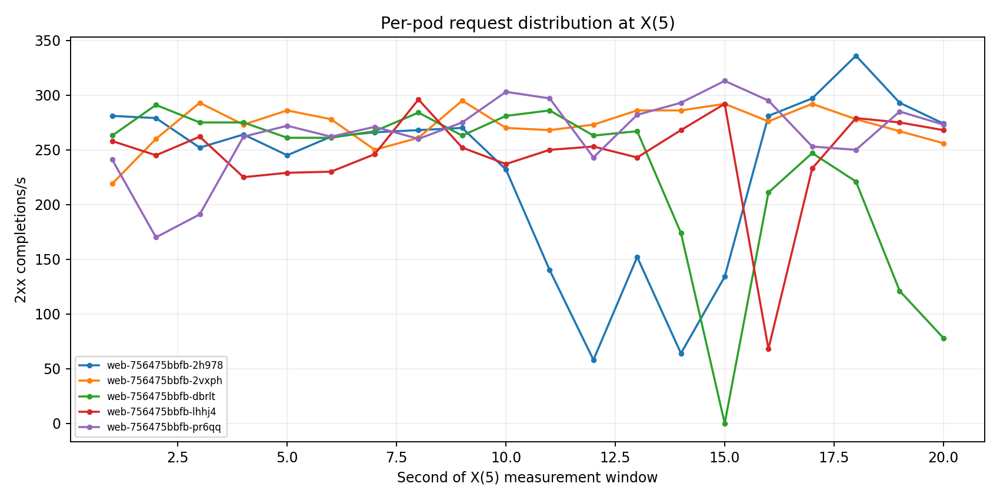
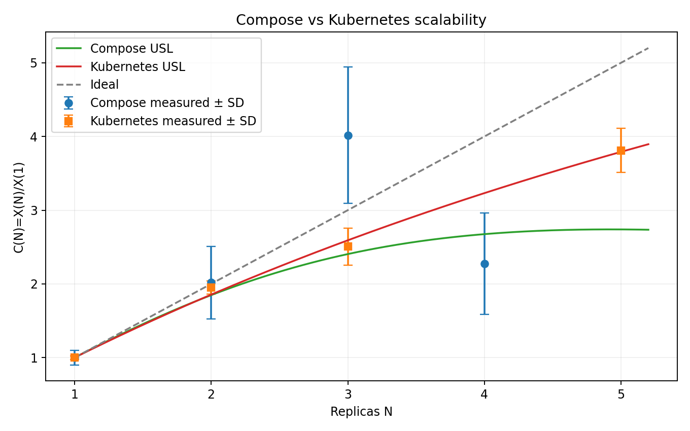
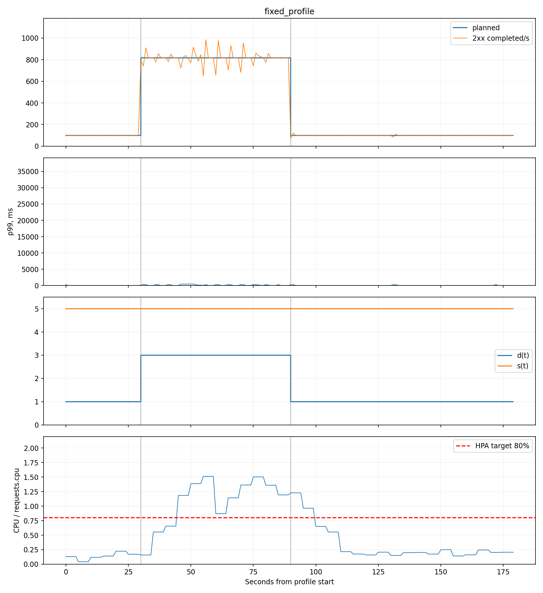
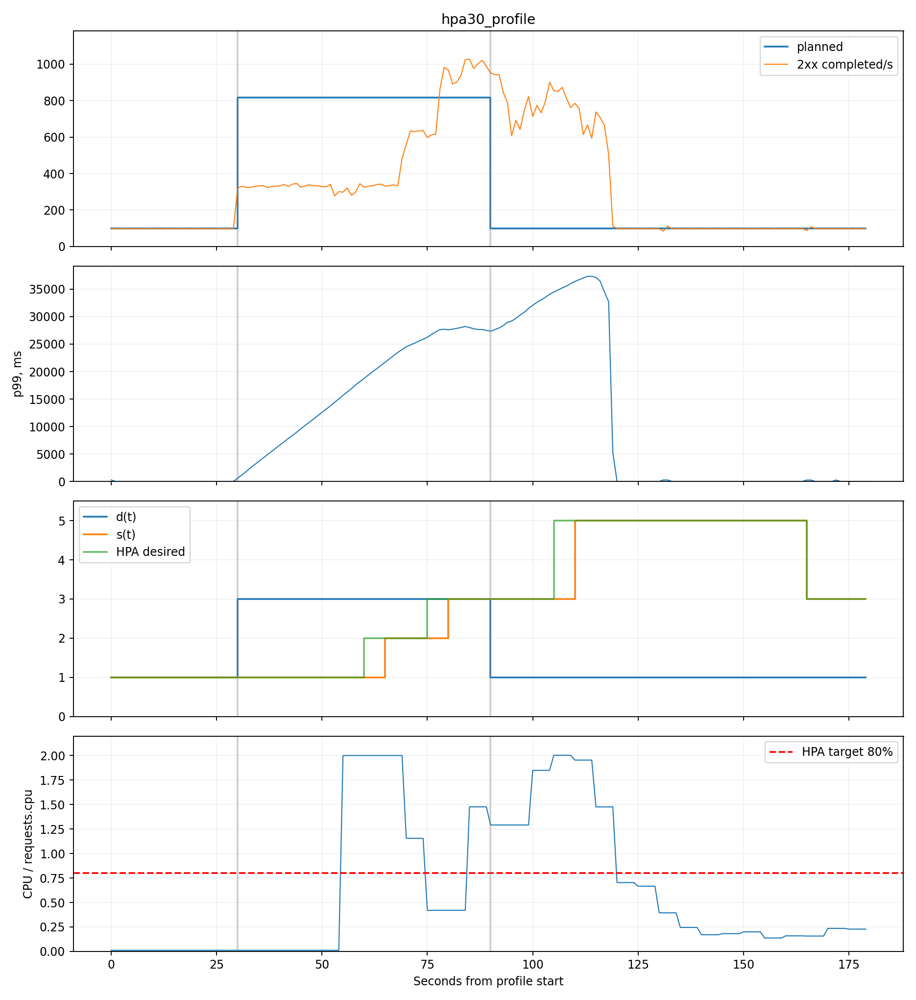
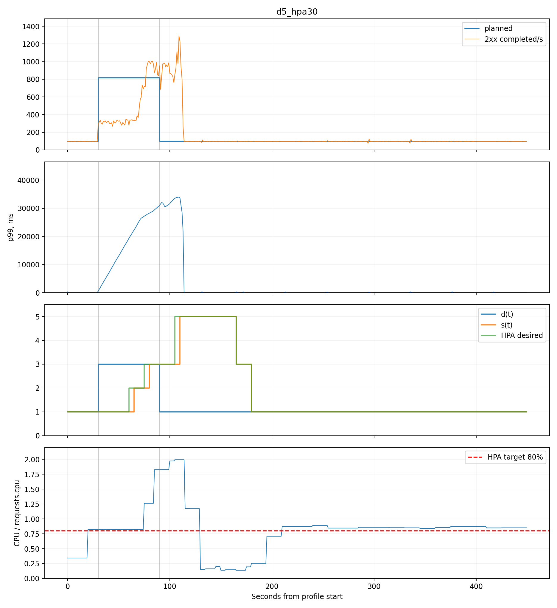
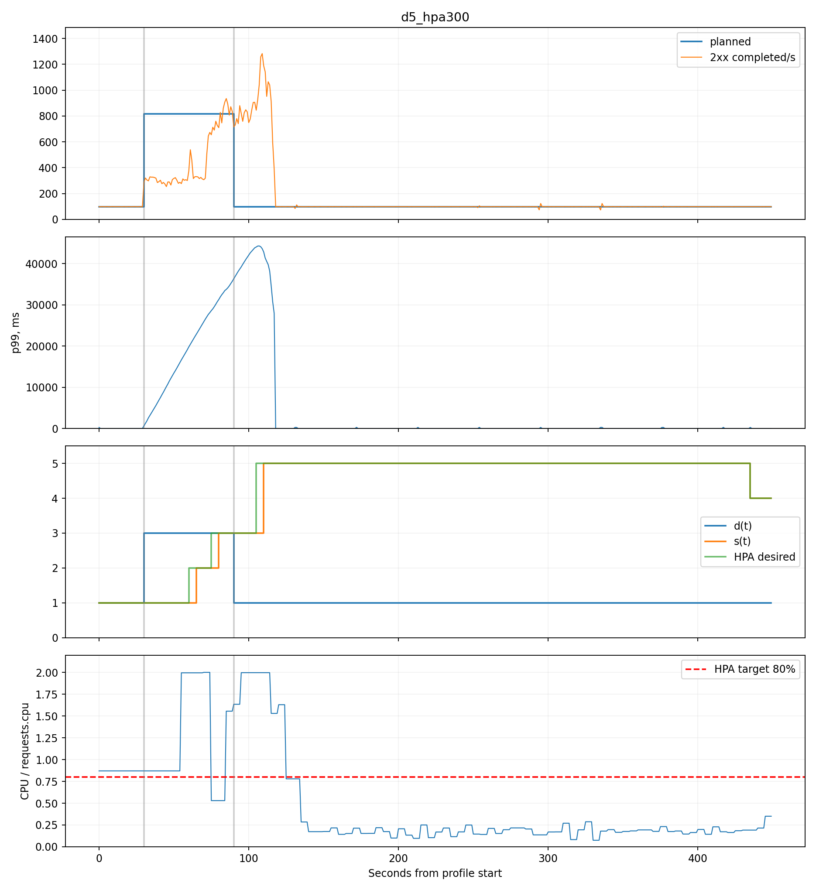

# Звіт до лабораторної роботи №3

**Тема:** сервіс у Kubernetes з автомасштабуванням і без нього  
**Варіант:** 2  
**Стенд:** kind, `R=5`, CPU request/limit `250m/500m`, HPA CPU 80 %, додаткова вимога Д5  
**Дата вимірювань:** 24–25 жовтня 2026 року

## 1. Мета та послідовність виконання

Сервіс лабораторної №2 разом із PostgreSQL і моніторингом перенесено до локального Kubernetes. Робота виконувалась у послідовності завдання: спочатку зафіксовано [проєктування](LAB3_DESIGN.md), далі створено кластер і маніфести, перевірено інфраструктуру й API, окремо перевірено генератор, виконано фіксовані прогони `N=1,2,3,5`, побудовано USL, потім виконано короткі fixed/HPA-профілі та два однакові 450-секундні прогони Д5.

Первинні HTTP-спроби є локальними незмінюваними JSONL. Через розмір вони виключені з Git, але кожен файл однозначно ідентифікований кількістю записів та SHA-256 у [raw-маніфесті](results/lab3_final/raw_manifest.json) і [README raw-даних](results/lab3_final/raw/README.md). Компактні summaries, метрики, розрахунки та графіки версіонуються.

## 2. Визначення метрик

- `z(t)` — кількість запланованих стартів за секунду.
- Досягнута інтенсивність — кількість успішно завершених відповідей `2xx` за фактичну секунду. HTTP не-`2xx`, timeout і transport error рахуються окремо.
- Клієнтська latency — від запланованого моменту старту до відповіді або помилки. Вона включає schedule lag, очікування worker/з’єднання, Docker port forwarding, kube-proxy та серверний час.
- Сходинка триває 30 с. `X` — середнє `2xx/s`, а розкид — вибіркове SD двадцяти посекундних значень останніх 20 с.
- Серверний p99 — середнє збережених 5-секундних значень Prometheus-запиту `histogram_quantile(0.99, sum by(le)(rate(...[20s])))` усередині того самого 20-секундного вікна. Per-pod p99 використовує аналогічний запит із групуванням `by(pod,le)`.
- Throttling pod — `rate(container_cpu_cfs_throttled_periods_total[20s]) / rate(container_cpu_cfs_periods_total[20s])`. Через оновлення cAdvisor приблизно раз на 10–15 с для середнього pod використано фактичні ненульові точки в межах `[початок−1 с; кінець+11 с]`; це явно зафіксовано в [аналізі](results/lab3_final/analysis.json).
- `I=Xmax/Xavg`, де per-pod `X` визначено з успішних відповідей за `X-Pod` у вікні `X(N)`.
- `s(t)` — ready replicas як кусочно-стале значення між фактичними точками Prometheus; `d(t)` — найменше `N`, для якого `X(N)>=z(t)`. Для невиміряного `N=4` використано USL-прогноз.
- Порушення latency-порогу — секунда, де посекундний клієнтський p99 перевищує `2*p99₀`. Виміряно `p99₀=248.765 мс`, отже поріг `497.529 мс`.

Усі похідні значення повторно обчислені незалежним скриптом без імпорту основного аналізатора. Результат: 9 прогонів, 1 319 938 raw-записів, усі SHA-256, `X`, SD, per-pod counts, USL і метрики еластичності збіглися; див. [незалежну перевірку](results/lab3_final/independent_verification.json).

## 3. Кластер і розгортання

[Конфігурація kind](k8s/kind-cluster.yaml) створює один `control-plane` і два `worker`, а також відображає `localhost:8080 -> NodePort 30080` та `localhost:9090 -> NodePort 30090`. Скрипт [deploy_lab3.ps1](scripts/deploy_lab3.ps1) створює/обирає кластер, ставить `role=infra`, створює Secret без друку його значень, збирає і завантажує образ, застосовує маніфести та чекає готовності компонентів. Повне видалення виконує [delete_lab3.ps1](scripts/delete_lab3.ps1).

Фактично використано:

| Компонент | Версія |
| --- | --- |
| kind | 0.33.0 |
| Kubernetes client/server | 1.36.1 / 1.36.1 |
| Helm | 4.3.1 |
| Docker Engine | 29.8.0 |
| kube-prometheus-stack | 92.7.0 |
| metrics-server chart | 3.14.0 |

Повторне розгортання з `-KeepExistingCluster` завершилося без помилок; у [повному transcript](results/lab3_final/commands/deploy.log) є `PowerShell transcript end` і рядок `Lab 3 cluster is ready`.

### PostgreSQL

[postgres.yaml](k8s/postgres.yaml) містить StatefulSet на вузлі `role=infra`, toleration control-plane, headless Service, PVC 1 GiB та `max_connections=100`. Окремий [Job міграції](k8s/migration-job.yaml) застосовує схему. Фактична команда

```text
kubectl -n lab3 exec postgres-0 -- sh -ec 'psql ... -Atc "show max_connections"'
```

повернула `100`; повний запис — [max_connections.json](results/lab3_final/commands/max_connections.json).

Для перевірки PVC створено запис, отримано його, виконано `kubectl delete pod postgres-0`, дочеканося нового pod і повторно отримано той самий запис. UID змінився з `34238a35-...` на `40816f4b-...`, останній HTTP-код — 200, повне тіло збіглося; див. [persistence_check.json](results/lab3_final/http/persistence_check.json).

### Web і безпека

[web.yaml](k8s/web.yaml) містить Deployment без `replicas`, NodePort Service, `DB_POOL_SIZE=15`, адресу headless Service, пароль через `secretKeyRef`, `POD_NAME` через Downward API, `250m/500m`, memory limit 512 MiB, задані probes, `preStop.sleep.seconds=5` і `terminationGracePeriodSeconds=15`.

Через `localhost:8080` виконано `POST → GET → PUT → DELETE → GET`; коди `201, 200, 200, 204, 404`. У [CRUD-журналі](results/lab3_final/http/crud_check.json) для кожного кроку є UTC-час, метод, шлях, request body, повне response body, код і `X-Pod`.

[Перевірка секрету](results/lab3_final/security_check.json) підтвердила: значення пароля відсутнє в усіх tracked і неігнорованих untracked-файлах, image inspect, ConfigMap та Deployment spec; `.env` ігнорується. Сам пароль у доказ не записано.

### Моніторинг

Prometheus має scrape interval 5 с; Prometheus Operator, Prometheus і kube-state-metrics розміщено на `role=infra`. Metrics Server запускається з `--kubelet-insecure-tls`. Postgres exporter та PodMonitor описані в [monitoring-resources.yaml](k8s/monitoring-resources.yaml).

Фінальна жива перевірка зафіксувала:

- `monitoring/web` і `monitoring/postgres-exporter` — `up`;
- наявні ряди web requests, CFS periods, ready replicas, HPA desired replicas та `pg_up`;
- `kubectl -n lab3 top pods` повертає CPU/RAM для web, PostgreSQL та exporter;
- `/livez` і `/healthz` повертають 200.

Команди, повні відповіді Prometheus і targets збережені в [infra_check.json](results/lab3_final/infra_check.json). Шість targets компонентів control-plane kind (`controller-manager`, `etcd`, `kube-proxy`, `scheduler`) були `down` через недоступні bind-порти. Вони не належать до web/PostgreSQL-перевірки, але цей факт не приховано і не названо повністю здоровим Prometheus.

## 4. Генератор і контроль його меж

[Генератор](scripts/lab3_generator.py) примусово використовує рівно `8*R=40` логічних постійних з’єднань. Кожний worker послідовно виконує запити та після 100 спроб закриває session/connector і створює новий. Scheduler є open-loop; latency починається в planned timestamp. Черга, active requests, schedule lag і створення/повторне використання TCP зберігаються.

Незалежна перевірка для кожного worker підтвердила послідовність `1..100`; усі нефінальні sessions мають рівно 100 спроб. Профіль fixed створив 640 логічних sessions і 60 115 TCP reuses; короткий HPA — 640 і 60 099 відповідно. TCP creations можуть перевищувати sessions через перепідключення на шляху server/kube-proxy, тому рівність цих двох величин не заявляється.

Окремий `/bench/noop` через той самий NodePort дав максимум `G=2190.7 2xx/s` при заданих 2200/s. Дві наступні сходинки не досягли 90 % заданого: 1976.2 при 2400 та 2102.8 при 2600, тому контроль зупинився за правилом двох промахів. Помилок HTTP/transport не було.

Водночас уже при 2200/s `schedule lag p95=4480 мс`. На робочих точках N він становив від 1627 до **21 967 мс**. Отже standalone-шлях здатний завершувати більше запитів, ніж виміряне `X(5)`, але під повільними відповідями обов’язкова модель 40 послідовних з’єднань накопичує чергу. Тому `X(N)` нижче подано як end-to-end результат саме цієї заданої моделі, а великий клієнтський p99 не приписується лише серверу.

## 5. Фіксована кількість реплік

Для кожного N виконано один безперервний ступінчастий прогін без HPA на тій самій машині, що й лабораторну №2. Остання сходинка кожного прогону була нижча за 90 % заданої, тому насичення знайдено і всі чотири точки допущені до USL за формальним правилом завдання.

| N | Задано на сходинці, 1/с | X(N) ± SD, 2xx/с | client p99, мс | server p99, мс | throttling mean / max | schedule lag p95, мс | I |
| ---: | ---: | ---: | ---: | ---: | ---: | ---: | ---: |
| 1 | 400 | 326.65 ± 7.90 | 5878.13 | 242.57 | 0.943 / 0.943 | 5465.30 | 1.000 |
| 2 | 1000 | 637.30 ± 30.29 | 24424.35 | 147.86 | 0.976 / 1.000 | 21967.11 | 1.051 |
| 3 | 800 | 818.25 ± 82.82 | 2167.16 | 97.32 | 0.623 / 0.820 | 1626.86 | 1.056 |
| 5 | 1600 | 1244.80 ± 98.18 | 20335.16 | 96.60 | 0.931 / 0.991 | 15894.22 | 1.096 |

У всіх вимірювальних вікнах `non-2xx=0`, `timeout=0`, `connection error=0`. Високі throttling і CPU/request ratio близько 2 безпосередньо підтверджують дію ліміту 500m; але різницю client/server p99 також формує описана черга 40-з’єднаннєвого генератора.

Для N>1 деталізація найбільш/найменш навантаженого pod:

| N | Найбільш навантажений, 2xx/с | server p99, мс | throttle | Найменш навантажений, 2xx/с | server p99, мс | throttle |
| ---: | --- | ---: | ---: | --- | ---: | ---: |
| 2 | `web-...-dwbwr`, 335.05 | 95.92 | 0.951 | `web-...-fxpns`, 302.25 | 199.68 | 1.000 |
| 3 | `web-...-gckt9`, 287.95 | 96.40 | 0.622 | `web-...-gw2nx`, 265.05 | 71.89 | 0.428 |
| 5 | `web-...-2vxph`, 272.95 | 97.90 | 0.991 | `web-...-dbrlt`, 229.45 | 85.57 | 0.878 |



## 6. Універсальний закон масштабованості

За точками N=1,2,3,5 отримано:

```text
lambda = X(1) = 326.65 1/s
sigma  = 0.0775412
kappa  = 0.000427737
N*     = 46.44
RMSE X = 24.69 1/s
X_USL(4) = 1055.62 1/s
```

`N*=46.44` є лише формальною екстраполяцією далеко поза виміряним діапазоном `N<=5`; називати її практичним оптимумом цього стенда не можна. Саме `X_USL(4)` використано лише для `d(t)`.

Для Compose лабораторної №2: `sigma=0`, `kappa=0.0412715`, `N*=4.92`, але RMSE був 192.92 1/s і N=4 мав помилки. Тому спільний графік є порівнянням виміряних кривих та формальних fits, а не доказом універсальної переваги Kubernetes.



## 7. Fixed та HPA, короткий профіль

З виміряних `X(1)=326.65` і `X(5)=1244.8`:

```text
low   = 0.3*X(1) = 97.995 1/s
spike = min(2.5*X(1), 0.9*X(5)) = min(816.625, 1120.32) = 816.625 1/s
profile = 30 s low + 60 s spike + 90 s low
```

Перед HPA-прогоном `desired=current=ready=1` утримувалися понад 60 с; фактичні точки є у [stability log](results/lab3_final/stability/hpa30_profile.json). HPA: min 1, max 5, CPU 80 %, scale-down window 30 с.

| Режим | T, с | theta_U | theta_O | a_U | a_O | W, replica·s | p99 violations, с | HTTP не-2xx |
| --- | ---: | ---: | ---: | ---: | ---: | ---: | ---: | ---: |
| Fixed 5 | 180 | 0.000 | 1.000 | 0.000 | 3.333 | 900 | 0 | 0 |
| HPA 30 | 180 | 0.278 | 0.500 | 0.472 | 1.611 | 505 | 90 | 0 |

Fixed досяг у spike в середньому 816.58 2xx/s; HPA — 495.72 2xx/s. Після spike HPA-прогін завершував накопичену чергу, тому середні 311.92 2xx/s на останньому низькому відрізку не означають таку задану інтенсивність.

Події HPA від початку/кінця spike:

| Подія | Результат |
| --- | --- |
| Перша зміна desired після початку spike | 30 с |
| Готовність максимальної кількості реплік у межах spike | **не досягнуто**; 5 ready з’явились на секунді профілю 110, тобто через 80 с після початку spike і вже після його завершення |
| 10 с поспіль p99 нижче `1.2 * 368.635 = 442.362 мс` у межах spike | **не досягнуто** |
| Перше зменшення ready після кінця spike | 75 с |





## 8. Додаткова вимога Д5

Для чесного порівняння виконано два незалежні прогони однакової тривалості `T=450 с`: 30 с low, 60 с spike, 360 с low. Відрізнялось лише scale-down stabilization window — 30 або 300 с. Перед кожним прогоном HPA знову утримував одну репліку не менше 60 с.

| Вікно | theta_U | theta_O | a_U | a_O | W, replica·s | p99 violations, с | HTTP не-2xx | Перше зменшення ready після spike |
| ---: | ---: | ---: | ---: | ---: | ---: | ---: | ---: | ---: |
| 30 с | 0.111 | 0.200 | 0.189 | 0.644 | 775 | 84 | 0 | 75 с |
| 300 с | 0.111 | 0.800 | 0.189 | 3.078 | 1870 | 88 | 0 | 345 с |

Вікно 300 с не змінило початкову нестачу реплік у spike, бо scale-up behavior однаковий. Воно затримало перше фактичне зменшення ready на 270 с, збільшило `theta_O` з 0.2 до 0.8 та витрати з 775 до 1870 replica·s. Різниця прямо спостерігається у ready-series; твердження не виводиться лише з налаштування маніфесту.





## 9. Альтернативи проєктування

**Альтернатива 1 — окремі маніфести Prometheus, kube-state-metrics і RBAC замість kube-prometheus-stack.** Це допустимо, але відхилено через більший обсяг ручної RBAC/TLS-конфігурації та ризик несумісних kubelet/cAdvisor endpoint. Обраний chart усе одно доповнено власними PodMonitor і placement values.

**Альтернатива 2 — власний migration image замість стандартного postgres image + ConfigMap.** Такий image краще версіонує складні міграції, але для єдиного ідемпотентного `init.sql` створював би ще один build/load artifact без нового доказу. Обраний Job явно відокремлений від старту StatefulSet.

**Альтернатива 3 — статичний hostPath PersistentVolume замість default StorageClass kind.** Це дає явний host path, але жорстко прив’язує маніфест до конкретного kind-node. PVC через default provisioner достатній для перевірки видалення pod і краще переноситься між локальними кластерами.

**Альтернатива 4 — Prometheus annotations/additionalScrapeConfigs замість PodMonitor.** Допустима, але відхилена, бо PodMonitor зберігає селектор namespace/pod у декларативному Kubernetes-об’єкті й простіше перевіряється командою `kubectl get podmonitor`.

## 10. Відтворення

```powershell
python -m venv .venv
.\.venv\Scripts\python.exe -m pip install -r requirements-lab.txt
.\scripts\deploy_lab3.ps1
.\.venv\Scripts\python.exe scripts\run_lab3.py --phase checks
.\.venv\Scripts\python.exe scripts\run_lab3.py --phase stairs
.\.venv\Scripts\python.exe scripts\run_lab3.py --phase profiles
.\.venv\Scripts\python.exe scripts\analyze_lab3.py
.\.venv\Scripts\python.exe scripts\verify_lab3_results.py
.\.venv\Scripts\python.exe scripts\check_lab3_security.py
.\.venv\Scripts\python.exe scripts\check_lab3_tests.py
.\.venv\Scripts\python.exe scripts\audit_lab3.py
.\scripts\delete_lab3.ps1
```

Аналізатор не змінює JSONL. [raw_manifest.json](results/lab3_final/raw_manifest.json) дозволяє перед аналізом перевірити локальні SHA-256. Підсумковий [requirements audit](results/lab3_final/requirements_audit.json) перевіряє маніфести, докази, розрахунки, тести, графіки та всі локальні посилання звіту.

## 11. Матриця вимог і доказів

| Крок | Вимога | Прямий доказ |
| ---: | --- | --- |
| 1–2 | kind 1+2, ports, deploy/delete | [kind config](k8s/kind-cluster.yaml), [deploy log](results/lab3_final/commands/deploy.log), [delete command](scripts/delete_lab3.ps1), [delete log](results/lab3_final/commands/delete.log) |
| 3 | StatefulSet/PVC/headless/Secret/100/Job | [postgres](k8s/postgres.yaml), [migration](k8s/migration-job.yaml), [object dump](results/lab3_final/infra_objects.json), [SQL output](results/lab3_final/commands/max_connections.json) |
| 3 | Дані після delete pod | [persistence HTTP + UID](results/lab3_final/http/persistence_check.json) |
| 4 | Web config/resources/probes/shutdown | [web manifest](k8s/web.yaml), [sanitized objects](results/lab3_final/infra_objects.json) |
| 4 | CRUD і X-Pod | [повний HTTP-журнал](results/lab3_final/http/crud_check.json) |
| 4 | Пароль відсутній | [security check](results/lab3_final/security_check.json) |
| 5 | Prometheus/cAdvisor/KSM/exporter/top | [monitoring values](k8s/monitoring-values.yaml), [live evidence](results/lab3_final/infra_check.json) |
| 6 | 40 connections, rotation/100, 30/20 с | [generator](scripts/lab3_generator.py), [independent verification](results/lab3_final/independent_verification.json), [tests](results/lab3_final/tests.json) |
| 7–8 | N=1,2,3,5, X/SD/p99/CFS/I/per-pod | [analysis](results/lab3_final/analysis.json), [metrics](results/lab3_final/metrics/n5.json), [raw manifest](results/lab3_final/raw_manifest.json) |
| 9 | USL і Compose comparison | [analysis](results/lab3_final/analysis.json), [common figure](results/lab3_final/figures/usl_compose_kubernetes.png) |
| 10–12 | Fixed/HPA profile, події, elasticity | [profiles](results/lab3_final/profiles/short.json), [analysis](results/lab3_final/analysis.json), [HPA stability](results/lab3_final/stability/hpa30_profile.json) |
| 13, Д5 | 30 vs 300, однакове T=450 | [long profile](results/lab3_final/profiles/d5_long.json), [30 s metrics](results/lab3_final/metrics/d5_hpa30.json), [300 s metrics](results/lab3_final/metrics/d5_hpa300.json) |

## 12. Обмеження та висновок

Факти: усі дев’ять прогонів завершилися без HTTP не-2xx, timeout і transport errors; Kubernetes-точки зростали до 1244.8 2xx/s при N=5; HPA знизив replica·seconds, але не встиг набрати максимум під час 60-секундного spike; 300-секундне scale-down window значно збільшило overprovisioning.

Інтерпретація: для короткого профілю фіксовані п’ять реплік дають стабільнішу latency ціною постійного надлишку. HPA 30 с економить 395 replica·s, але має 50 секунд underprovisioning і 90 секунд порушення p99-порогу. У Д5 збільшення scale-down window до 300 с не допомагає spike, зате суттєво збільшує ресурсні витрати після нього.

Обмеження: великий schedule lag показує вплив обов’язкової 40-з’єднаннєвої моделі; причина всього client p99 не зводиться до Kubernetes або CPU. CFS має дискретне 10–15-секундне оновлення. `N*` — далека екстраполяція. Дві події HPA чесно записані як «не досягнуто». Шість несуттєвих для застосунку control-plane targets kind були down. Ці обмеження не скасовують виміряні факти, але обмежують силу узагальнення поза цим стендом і профілем.

## 13. Використання генеративних моделей

Генеративна модель використовувалась для підготовки Kubernetes-маніфестів, скриптів генератора/аналізу, тестів і тексту звіту. Після цього незалежно перевірено: застосування маніфестів реальним kind-кластером; фактичні HTTP bodies/codes/`X-Pod`; збереження даних після заміни pod; Prometheus series і `kubectl top`; відсутність секрету; SHA-256 та 1 319 938 raw-записів; повторний розрахунок `X`, SD, USL і elasticity без імпорту основного аналізатора; 23 автоматичні тести; фінальний аудит відповідності вимогам.
