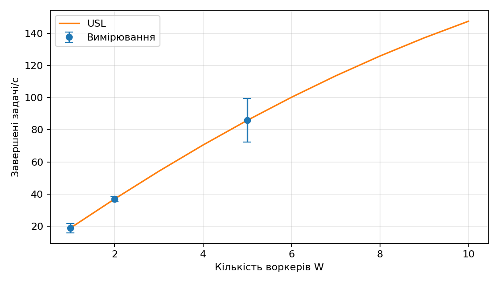
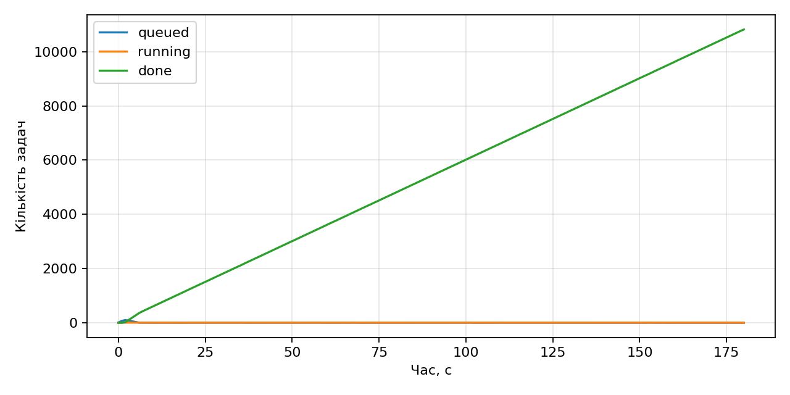
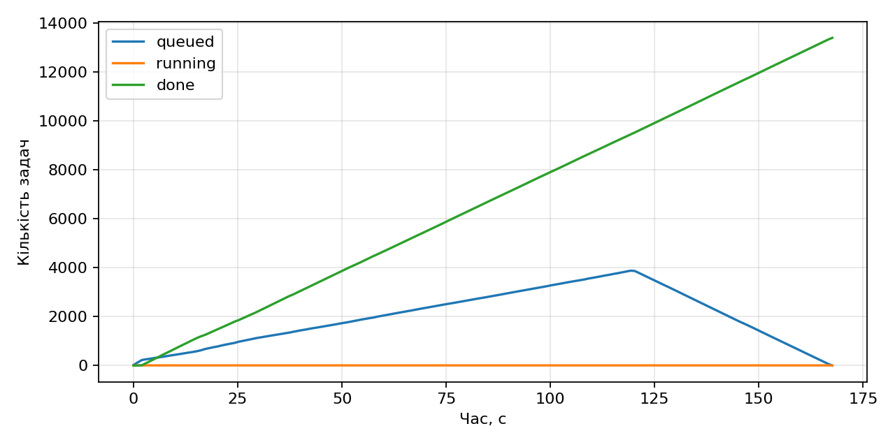
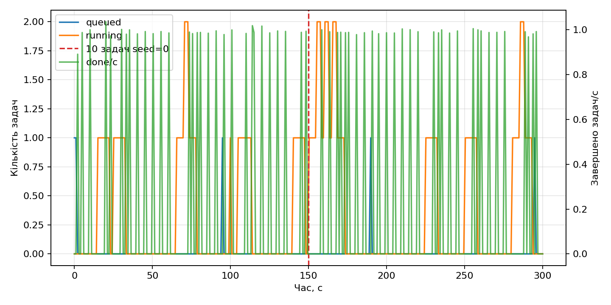

**Тема:** фонова обробка задач, конкурентне захоплення, lease/fencing і відмовостійкість  
**Варіант:** 2  
**Параметри варіанта:** `q_lo=0,05`, `q_hi=0,95`, `T_poll=100 мс`, `L=5 с`, сценарій Ф3, додаткова вимога Д1  
**Кількість воркерів:** `R=5`  
**Дата експериментів:** 8–9 листопада 2026 року

## 1. Мета і послідовність роботи

Метою роботи було доповнити сервіс направлень асинхронною чергою задач, реалізувати окремий worker, дослідити конкурентне захоплення задач, lease із fencing token, масштабованість, поведінку черги, коректне завершення pod та відмови процесу.

Структуру даних, API, алгоритм воркера, визначення метрик і перелік доказів зафіксовано у [проєктному документі](LAB4_DESIGN.md) та окремому Git-коміті `ed9325f`, що передує коміту реалізації ЛР4. Далі робота виконувалась у послідовності завдання: міграція й API; один worker; наївне та транзакційне захоплення; lease/fencing; серії `W=1,2,5`; закон Літтла; rollout restart; `FAIL_RATE=0,15` і Ф3; пріоритети Д1; незалежний перерахунок raw-даних і тести.

## 2. Реалізація

### 2.1. Схема даних

У [міграції](db/init.sql) створено дві таблиці. `tasks` містить посилання на направлення, стан `queued/running/done/failed`, пріоритет 1–3, seed, кількість спроб, `max_attempts=3`, fencing token, власника, lease та часові мітки. Індекс захоплення має порядок `(status, priority DESC, created_at, id)`. `task_results` має первинний ключ `task_id`, тому у фінальній схемі для однієї задачі фізично неможливо зберегти два результати.

Фактична SQL-інтроспекція підтвердила `PRIMARY KEY (task_id)`, зовнішні ключі, перевірки діапазонів і потрібні індекси; повний вивід збережено у [schema_check.json](results/lab4_final/schema_check.json). Для двох наївних експериментів унікальність результату тимчасово вимикалась керованою командою, після чого відновлювалась.

### 2.2. API

Реалізовано:

- `POST /referrals/{id}/tasks` — створення задачі, код 202;
- `GET /tasks/{id}` — стан задачі та результат;
- `GET /tasks?status=...&limit=...&offset=...` — фільтрація і пагінація.

`priority`, `seed` та межі PostgreSQL `BIGINT` перевіряються на межі API до звернення до нижнього рівня. У [HTTP-журналі](results/lab4_final/http/api_check.json) збережено метод, шлях, тіло запиту, код, повне тіло відповіді й заголовки. Отримано такі результати:

| Перевірка | Код | Результат |
| --- | ---: | --- |
| створення задачі `priority=3, seed=123` | 202 | створено `queued` задачу |
| список `status=queued` | 200 | повернуто один елемент і `total=1` |
| отримання задачі за id | 200 | повне тіло збігається |
| відсутнє направлення | 404 | `Направлення не знайдено` |
| `priority=0` / `priority=4` | 400 / 400 | відхилено до БД |
| `seed=2147483648` | 400 | відхилено до БД |
| id більший за `BIGINT` | 400 | відхилено до БД |

### 2.3. Worker і обробка

Worker винесено в окремий образ [Dockerfile.worker](Dockerfile.worker) і окремий Kubernetes Deployment. Реалізація знаходиться у [worker/main.py](worker/main.py), SQL-операції — у [репозиторії задач](backend/data/postgres_task_repository.py), а синтетична обробка — у [worker/processing.py](worker/processing.py).

Для зрізу `S=256` використано заданий LCG без NumPy/Numba. Обчислюються квантилі 0,05 і 0,95, кількість вилучених значень, середнє та стандартне відхилення. `seed=0` навмисно породжує виняток для сценарію Ф3.

Нормальне захоплення виконується однією транзакційною SQL-командою з `FOR UPDATE SKIP LOCKED`. Кожне захоплення збільшує token. Heartbeat, запис результату та зміна стану містять умову `id AND token`, тому старий власник не може продовжити lease або завершити задачу. Запис результату і перехід у `done` виконуються в одній транзакції.

Експонуються лічильники задач і захоплень, gauge in-flight та гістограми `claim/fetch/process/store`. Web-процес кожні 5 с повертає прострочені lease і оновлює gauge черги.

## 3. Визначення метрик

- `X(W)` — кількість задач, що успішно перейшли у `done`, поділена на фактичну тривалість перетину останніх 30 с з інтервалом непорожньої черги. `failed` і повторні обробки не входять до чисельника.
- `D=n_dup/n`, де `n_dup` — кількість різних `task_id` з більш ніж одним результатом або більш ніж одним `task_done` у журналі, а `n` — кількість задач серії.
- `p99 claim` — 99-й перцентиль raw-тривалостей операції claim.
- `lambda` — кількість створених задач у вікні, поділена на фактичну тривалість вікна.
- `W_q` — середній час `started_at-created_at`; `L_q` — незалежний часово-зважений ряд кількості `queued` за фактичними моментами SQL-вибірок.
- Додатково для системної форми закону Літтла використано `W_system=finished_at-created_at` і незалежний `L_unfinished=queued+running`.
- У open-loop генераторі затримка планування вимірюється від запланованого моменту. У всіх основних серіях p95 schedule lag був близько 0,6 мс, тому генератор не був прихованим обмеженням.

Raw JSONL не змінюються аналізатором. Вони стиснені детермінованим gzip; кількість записів і SHA-256 наведено в [raw-маніфесті](results/lab4_final/raw_manifest.json).

## 4. Розгортання і базова перевірка

Стенд розгорнуто в kind-кластері з одним control-plane і двома worker-вузлами. Namespace `lab4` містить PostgreSQL StatefulSet із PVC, Job міграції, web, п’ять worker pod, PostgreSQL exporter, PodMonitor і Prometheus stack. Ідемпотентна команда

```powershell
.\scripts\deploy_lab4.ps1 -KeepExistingCluster
```

повторно зібрала образи, застосувала міграцію й маніфести та завершилась рядком `ЛР4 готова`. Текстовий журнал є у [deploy.log](results/lab4_final/commands/deploy.log), а точні команди разом із фактичними таблицями `nodes`, `pods`, `statefulset/deployments/services/PVC/jobs` збережено у [infra_check.json](results/lab4_final/infra_check.json). У фінальному стані PostgreSQL, web, exporter і всі 5 worker pod були Ready; PVC — Bound, migration Job — Complete.

Один worker обробив 20 із 20 задач без помилок і дублів. Середні тривалості кроків:

| Крок | Середній час, с |
| --- | ---: |
| fetch | 0,002632 |
| process | 0,046322 |
| store | 0,003042 |
| `t_io=fetch+store` | 0,005674 |

Грубий прогноз із формули `1/(t_io+t_cpu+T_poll/2)` дорівнює 9,80 задачі/с. Фактично `X(1)=18,85 задачі/с`, оскільки під постійно непорожньою чергою worker не сплачує середні `T_poll/2` між кожними двома задачами. Тому цю формулу слід вважати консервативною оцінкою, а не точним передбаченням.

## 5. Конкурентне захоплення і дублікати

Для кожної серії створено 300 задач, `R=5`, задана інтенсивність 100 задач/с. У наївному режимі `SELECT` і `UPDATE` виконувалися послідовно без штучної паузи, але залишалися двома окремими командами, тому кілька процесів могли обрати одну задачу. Для порівняння виконано `SKIP LOCKED` і блокуючий `FOR UPDATE`.

| Режим | `T_poll`, мс | Дубльовані id за БД / логами | D | p99 raw, мс | p99 гістограма, мс | task / empty claims | max lock waiters |
| --- | ---: | ---: | ---: | ---: | ---: | ---: | ---: |
| naive | 100 | 42 / 42 | 0,1400 | 31,00 | 2,49 | 346 / 27 | 0 |
| naive | 1 | 40 / 40 | 0,1333 | 44,46 | 2,49 | 342 / 1853 | 0 |
| `SKIP LOCKED` | 1 | 0 / 0 | 0 | 32,63 | 24,71 | 300 / 1446 | 0 |
| `FOR UPDATE` | 1 | 0 / 0 | 0 | 38,88 | 23,83 | 300 / 1711 | 0 |

Факт дублювання підтверджено незалежно таблицею результатів і подіями `task_done`. Точні `task/empty` counters знято безпосередньо з `/metrics` кожного з п'яти pod і збережено у `worker_metrics_snapshot.json`; для `FOR UPDATE` отримано 300 успішних і 1711 порожніх захоплень. p99 з raw-подій наведено окремо від обов'язкового p99 Prometheus-гістограми. Після зменшення `T_poll` від 100 до 1 мс значення `D` змінилося на `-0,0067`, тому ці дві серії не показали суттєвого впливу інтервалу опитування на частку дублів. Обидва транзакційні режими дали `D=0`; у цій невеликій серії секундний sampler не зафіксував lock waiters, тому робити загальний висновок про відсутність блокувань для великих пакетів не можна.

## 6. Lease і fencing

Параметри досліду: два worker, 100 задач, `L=5 с`, зупинка одного worker на `2L=10 с`. Для вибраної задачі до зупинки були `attempts=1`, `token=1`, власник A. Після завершення lease задача була захоплена worker B: `attempts=2`, `token=2`, стан `done`. Після відновлення A у журналі з’явилися:

```text
stale_store, task_id=13, token=1, updated_rows=0
stale_heartbeat, task_id=13, token=1, updated_rows=0
```

У БД залишився рівно один результат. Загалом 100/100 задач завершено, одна задача мала дві спроби, дублікати відсутні. Знімки до, під час і після відновлення є у [lease_case.json](results/lab4_final/runs/lease_fencing/lease_case.json), а raw-журнал — у [worker.log](results/lab4_final/runs/lease_fencing/worker.log).

Важливе відхилення середовища: обов’язкова команда `kubectl exec ... kill -STOP 1` повернула код 0, але `/proc/1` не перейшов у стан `T`; це зафіксовано у [kubectl_stop_probe.json](results/lab4_final/runs/lease_fencing/kubectl_stop_probe.json). Для виміряного досліду еквівалентний `SIGSTOP/SIGCONT` було надіслано зовнішньому runtime PID контейнера через `crictl`, і стан `T` перевірено. Тобто властивість fencing доведено, але точна команда з методички в локальному kind не відтворила потрібну паузу.

## 7. Пропускна здатність і USL

Для `W=1,2,5` виконано по 400 задач.

| W | Завершено | Фактичне вікно, с | X(W), задач/с | SD за секунду | p99 claim, мс | DB TPS | DB CPU, core |
| ---: | ---: | ---: | ---: | ---: | ---: | ---: | ---: |
| 1 | 400 | 21,224 | 18,847 | 2,970 | 35,59 | 81,12 | 0,0776 |
| 2 | 400 | 10,830 | 36,936 | 1,690 | 38,60 | 127,64 | 0,1108 |
| 5 | 400 | 4,659 | 85,852 | 13,583 | 40,43 | 165,09 | 0,1464 |

Задані 400 задач вичерпались швидше ніж за 30 с. Щоб не підмінювати їх штучною затримкою і водночас прямо перевірити повне вікно, окремо виконано підтверджувальні серії з більшим початковим backlog. Вони не змішуються із серіями по 400 задач:

| W | Початковий backlog | Вікно, с | X(W), задач/с | SD за секунду | p99 claim raw, мс |
| ---: | ---: | ---: | ---: | ---: | ---: |
| 1 | 800 | 30,000 | 18,467 | 0,730 | 38,94 |
| 2 | 1600 | 30,000 | 36,133 | 0,900 | 39,67 |
| 5 | 4000 | 30,000 | 83,167 | 2,019 | 34,41 |

У всіх трьох підтверджувальних серіях `full_30_second_window=true`; значення близькі до коротких обов'язкових серій. USL нижче лишено за серіями з рівно 400 задачами, щоб не змішувати різні експериментальні серії.

Для USL використано `C(W)=X(W)/X(1)` та `y=W/C(W)-1=σ(W-1)+κW(W-1)`:

| W | C(W) | y | u | v |
| ---: | ---: | ---: | ---: | ---: |
| 2 | 1,959783 | 0,020521 | 1 | 2 |
| 5 | 4,555208 | 0,097645 | 4 | 20 |

Суми нормальних рівнянь: `Σu²=17`, `Σv²=404`, `Σuv=82`, `Σuy=0,411100`, `Σvy=1,993936`, визначник `D=144`. Отримано `σ=0,0179282`, `κ=0,00129660`; обидва коефіцієнти невід’ємні, тому проєкція на межу не застосовувалась. Формальне `W*=sqrt((1-σ)/κ)=27,52` лежить далеко поза виміряним діапазоном `W<=5`, тому не є практично доведеним оптимумом.



## 8. Черга і закон Літтла

Стаціонарний профіль тривав 180 с при `0,7X(5)=60,096 задачі/с`: заплановано, прийнято і завершено 10 817 задач, HTTP/transport errors — 0. Для останніх 120 с отримано:

| Величина | Значення |
| --- | ---: |
| `lambda` | 60,0917 задачі/с |
| `W_q` | 0,020747 с |
| незалежне `L_q` | 1,17143 задачі |
| `lambda*W_q` | 1,24672 задачі |
| розбіжність | 6,43 % |
| `W_system` | 0,069748 с |
| незалежне `L_unfinished` | 4,44385 задачі |
| `lambda*W_system` | 4,19129 задачі |
| системна розбіжність | 5,68 % |

`L_q` і `L_unfinished` отримані з незалежних SQL-знімків із фактичними timestamps, а не виведені з тих самих затримок. Розбіжність пояснюється дискретністю приблизно секундних вибірок та коротким часом перебування задач у системі.

У перевантаженні `1,3X(5)=111,607 задачі/с` за 120 с створено 13 393 задачі. На кінці генерації в черзі було 3 876 задач; `W_q` перших 100 задач становив 2,12 с, останніх 100 — 47,41 с. `L_q=2002,63`, тоді як `lambda*W_q=2797,07`, розбіжність 39,67 %. Закон Літтла не повинен збігатися для нестаціонарного інтервалу з наростаючою чергою; цей запуск показує порушення припущення стаціонарності, а не помилку формули.





## 9. Коректне завершення під навантаженням

Під час 120-секундного профілю `0,7X(5)` на 60-й секунді виконано `kubectl rollout restart deployment/worker`. Результат: 7 212 заплановано, 7 212 прийнято, 7 212 завершено, `failed=0`, дублів 0, HTTP/transport errors 0, задач із `attempts>1` — 0.

Після SIGTERM worker припиняє нові захоплення і відраховує 20 с від моменту сигналу при `terminationGracePeriodSeconds=30`. Якщо поточна задача не завершилася за цей час, вона повертається у `queued` командою з умовами `id`, `token`, `status='running'` і `worker_id`. У цьому прогоні всі поточні задачі завершилися швидше, тому чотири старі pod записали `returned=0`, `worker_stopped` та `exit_code=0`; у [спостереженнях rollout](results/lab4_final/runs/graceful_restart/rollout_observation.json) зафіксовано termination reason `Completed` і `exitCode=0`. Окремий регресійний тест примусово вичерпує 20-секундний бюджет і перевіряє повернення поточної задачі з умовою token.

## 10. Відмови worker і сценарій Ф3

### 10.1. Baseline з `FAIL_RATE=0,15`

У повторному 300-секундному вікні open-loop генератор прийняв 18 029/18 029 задач без HTTP-помилок, p95 schedule lag — 0,606 мс. На межі вимірювання було `done=139`, `failed=0`, `queued=17890`; сумарно в pod було 25 рестартів. Отже виміряний `X=139/300=0,463 задачі/с`.

Після `os._exit(1)` pod переходив у Kubernetes `CrashLoopBackOff`; за 300 с зафіксовано 25 рестартів. Через паузи між рестартами 17 886 задач не були захоплені жодного разу, тому їх вилучено зі знаменника під час порівняння часток спроб.

На межі 300 с незалежно збережено повний snapshot задач. Розподіл захоплень був `attempts=0:17886, 1:120, 2:20, 3:3`. Хоча б одну спробу мали 143 задачі; повторно захоплено 23 із них, тобто `23/143=16,1 %`, що близько до `f=15 %`. Частка `failed` дорівнювала `0/143=0 %`. За теоретичної ймовірності `f³=0,3375 %` для 143 захоплених задач очікуване число остаточних відмов становить лише 0,48, тому відсутність `failed` у цій вибірці не суперечить теоретичній оцінці.

Після завершення рівно 300 с `FAIL_RATE` було встановлено в 0 лише для контрольованого дренування збереженої черги. Фінально: `done=18029`, `failed=0`, розподіл спроб `1:18002, 2:24, 3:3`, дублів 0. Ці фінальні числа не використовувались як 300-секундна пропускна здатність.

### 10.2. Ф3: десять задач `seed=0`

У початковій перевантаженій серії worker після приблизно 110-ї секунди не завершували задач, а десять poison-задач додавалися на 150-й секунді. Тому їхні стани після дренування з `FAIL_RATE=0` не використано як результат Ф3. Для Ф3 виконано окрему пару 300-секундних серій з `FAIL_RATE=0,15` та інтенсивністю 0,2 задачі/с: baseline із 60 звичайними задачами і серію з тими самими 60 звичайними та 10 poison-задачами на 150-й секунді.

На 300-й секунді, до перемикання `FAIL_RATE` у 0, усі 10 poison-задач мали `status=failed` і `attempts=3`. Час від створення до `failed`: медіана 0,112851 с, p99 0,168947 с. Для звичайних задач p99 `W_q` у тому самому вимірювальному snapshot становив 9,861323 с у baseline і 8,428234 с у серії Ф3; різниця `-1,433089 с` (`-14,5 %`). У цих двох малих серіях погіршення p99 не спостерігалося; різниця може залежати від випадкових відмов і планування pod. Подальша фаза з `FAIL_RATE=0` використовувалася тільки для контрольованого очищення й не є джерелом наведених величин Ф3.

Sampler зберігав кожну фактичну SQL-вибірку під час запуску. Діаграма нижче обмежена 300-секундним вимірювальним вікном, показує `tasks_queued`, `tasks_running`, завершені задачі за секунду і вертикальну позначку додавання десяти poison-задач на 150-й секунді.



## 11. Додаткова вимога Д1 — пріоритети

Під навантаженням `1,3X(5)` створено рівні частки пріоритетів 1, 2 і 3. У SQL кожне захоплення сортує доступні рядки як `priority DESC, created_at, id`.

| Пріоритет | Кількість | Середній `W_q`, с | p50, с | p99, с |
| ---: | ---: | ---: | ---: | ---: |
| 1 | 4465 | 73,360 | 74,757 | 103,308 |
| 2 | 4464 | 0,278 | 0,045 | 3,148 |
| 3 | 4464 | 0,042 | 0,012 | 1,263 |

Отже перевага вищого пріоритету безпосередньо видима у затримках. Водночас у 277 із 13 393 стартів (2,07 %) нижча задача почалася раніше за вже створену вищу задачу, яка стартувала пізніше. Це очікуваний ефект п’яти конкурентних транзакцій із `SKIP LOCKED`: вища задача могла бути вже заблокована іншим worker, тому поточний worker брав наступну доступну. Реалізована Д1 є неблокуючим пріоритетом для доступних задач, а не строгим глобальним серіалізованим порядком.

## 12. Розглянуті альтернативи

1. **Окремі `SELECT` і `UPDATE` для claim.** Це простіше, але на фактичних даних дало `D=0,64–0,70`, тому варіант залишено лише як негативний експеримент.
2. **`FOR UPDATE` без `SKIP LOCKED`.** Він також дав `D=0`, але p99 raw claim був 38,88 мс проти 32,63 мс у `SKIP LOCKED`, а порожніх захоплень — 1711 проти 1446. Для цього проєкту обрано неблокуюче захоплення; на більшому batch потрібен окремий тест блокувань.
3. **Зберігати результат через `ON CONFLICT DO UPDATE`.** Це дозволило б старій спробі перезаписати чинний результат. Обрано `PRIMARY KEY(task_id)`, `ON CONFLICT DO NOTHING` і перевірку token в одній транзакції.
4. **Повертати прострочені lease лише самими worker.** За відсутності живих worker така черга не відновилась би. Тому reaper розміщено у web Deployment, який уже є постійним компонентом системи.

## 13. Відтворюваність і перевірки

Основні команди:

```powershell
python -m venv .venv
.\.venv\Scripts\python.exe -m pip install -r requirements-lab.txt
.\scripts\deploy_lab4.ps1 -KeepExistingCluster
.\.venv\Scripts\python.exe -B scripts\run_lab4.py --phase api
.\.venv\Scripts\python.exe -B scripts\run_lab4.py --phase worker
.\.venv\Scripts\python.exe -B scripts\run_lab4.py --phase claims
.\.venv\Scripts\python.exe -B scripts\run_lab4.py --phase naive
.\.venv\Scripts\python.exe -B scripts\run_lab4.py --phase lease
.\.venv\Scripts\python.exe -B scripts\run_lab4.py --phase capacity
.\.venv\Scripts\python.exe -B scripts\run_lab4.py --phase capacity30
.\.venv\Scripts\python.exe -B scripts\run_lab4.py --phase queue --x5 85.85163164357166
.\.venv\Scripts\python.exe -B scripts\run_lab4.py --phase shutdown --x5 85.85163164357166
.\.venv\Scripts\python.exe -B scripts\run_lab4.py --phase failures --x5 85.85163164357166
.\.venv\Scripts\python.exe -B scripts\run_lab4.py --phase poison
.\.venv\Scripts\python.exe -B scripts\run_lab4.py --phase priority --x5 85.85163164357166
.\.venv\Scripts\python.exe -B scripts\analyze_lab4.py
.\.venv\Scripts\python.exe -B scripts\recalculate_lab4_hashes.py
.\.venv\Scripts\python.exe -B scripts\package_lab4_raw.py
.\.venv\Scripts\python.exe -B scripts\verify_lab4_results.py
.\.venv\Scripts\python.exe -B scripts\run_lab4_tests.py
```

[Незалежний verifier](results/lab4_final/independent_verification.json), який не імпортує основний аналізатор, перевірив 20 серій і 89 923 HTTP-запити: SHA-256 усіх raw JSONL, кількості запитів і задач, `X(W)` із `finished_at`, повні 30-секундні capacity-вікна, точні `task/empty` claims, failure-snapshot на 300-й секунді, частки спроб лише за захопленими задачами, стан десяти poison-задач до дренування, відсутність дублів у фінальних режимах та незалежні `lambda`, `W_q`, `L_q`. Під час перевірки було знайдено і задокументовано помилку метаданих хешів через Windows CRLF; raw-файли не змінювались, а корекцію записано у [hash_correction.json](results/lab4_final/hash_correction.json).

Повний `unittest discover` завершився результатом `Ran 41 tests ... OK`; машинний журнал є у [tests.json](results/lab4_final/tests.json). Тести охоплюють межі API/типів, poison seed, детермінованість зрізу, збереження обов'язкових доказів, схему й маніфест, квантиль, USL, а також регресії відсутності штучної паузи, timeout під час SIGTERM, token-умови повернення задачі та SQL повторної спроби.

## 14. Обмеження і висновки

Без штучної паузи наївне захоплення дало 42 дубльовані задачі з 300 при `T_poll=100 мс` і 40 з 300 при `T_poll=1 мс`; `SKIP LOCKED` та `FOR UPDATE` дали `D=0`. Пропускна здатність зросла від 18,85 задачі/с для одного worker до 85,85 задачі/с для п'яти. Після rollout restart усі 7 212 задач завершилися без повторних спроб і дублів. У failure-прогоні повторне захоплення мали 23 із 143 захоплених задач, або 16,1 % при заданому `FAIL_RATE=15 %`. В окремій Ф3-серії всі 10 poison-задач перейшли у `failed` після трьох спроб ще до контрольованого дренування.

Для цього стенда `SKIP LOCKED` усунув дублікати без серіалізації worker, а lease з token відкинув застарілий запис після паузи довше `L`. Стаціонарна перевірка закону Літтла дала розбіжність 5,68–6,43 %; у перевантаженому прогоні черга зростала, тому стаціонарне співвідношення до всього 120-секундного інтервалу не застосовувалося.

Обов'язкові серії по 400 задач тривали менше 30 с, тому повне 30-секундне вікно перевірено окремими серіями зі збільшеним backlog. USL побудовано за трьома точками, а `W*=27,52` є екстраполяцією. У 300-секундному failure-прогоні 17 886 із 18 029 задач не були захоплені через паузи `CrashLoopBackOff`, тому частки спроб обчислено тільки за 143 захопленими задачами. Для перевірки Ф3 використано окрему малу інтенсивність 0,2 задачі/с. Команда `kubectl exec ... kill -STOP 1` не зупинила PID 1 у цьому PID namespace, тому в lease-сценарії зупинено зовнішній runtime PID. У Д1 зафіксовано 2,07 % інверсій, отже `SKIP LOCKED` не забезпечив строгого глобального порядку.

## 15. Використання генеративної моделі

У процесі виконання роботи OpenAI Codex застосовувався як допоміжний інструмент для підтримки проєктування, розробки програмного коду, підготовки Kubernetes-маніфестів, реалізації оркестратора експериментів, аналізатора результатів та автоматизованих тестів. Використання технологій штучного інтелекту було спрямоване на оптимізацію окремих етапів розробки та підвищення ефективності виконання технічних завдань. Коректність реалізованих рішень перевірялася шляхом практичного розгортання системи в середовищі kind, виконання HTTP-запитів, аналізу структури та вмісту бази даних, журналів роботи pod і метрик Prometheus. Додаткову перевірку забезпечено виконанням 41 автоматизованого тесту і незалежним перерахунком результатів на основі первинних даних. Аналіз отриманих результатів, їх інтерпретація, формулювання висновків та підготовка остаточної редакції звіту здійснювалися самостійно.
